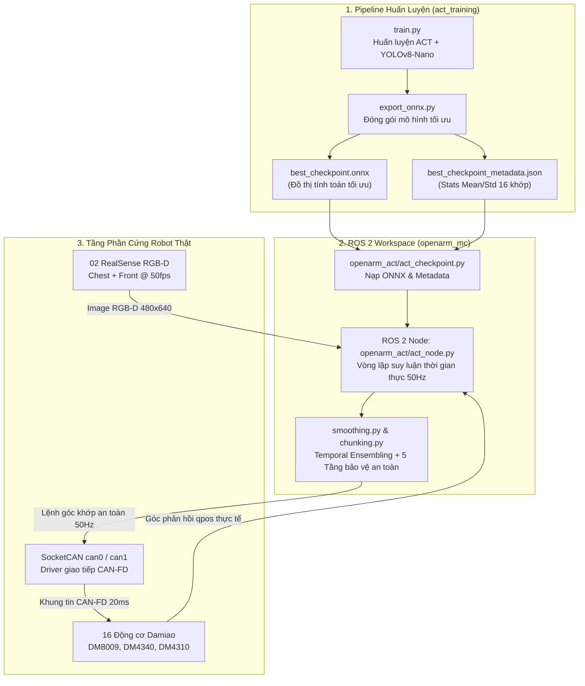

# HƯỚNG DẪN TRIỂN KHAI MÔ HÌNH LÊN ROBOT THẬT (ROS 2 & SOCKETCAN)
## PHYSICAL ROBOT DEPLOYMENT GUIDE: FROM ONNX CHECKPOINT TO 50HZ CLOSED-LOOP CONTROL
> **Robot áp dụng**: OpenArm Bimanual 16-DOF (2 tay x [7 bậc tự do xoay + 1 kẹp Gripper] động cơ Damiao CAN-FD)  
> **Cảm biến thị giác**: 02 Camera Intel RealSense D435/D405 RGB-D (Chest Camera + Front Camera)  
> **Hệ điều hành**: Ubuntu 22.04 LTS (Native hoặc WSL 2) + ROS 2 Humble  
> **Giao thức điều khiển tầng thấp**: SocketCAN (`can0`, `can1` @ 1Mbps arbitration / 5Mbps data bitrate)  

---

## 1. KIẾN TRÚC CẦU NỐI TOÀN DIỆN (DEPLOYMENT TOPOLOGY)

Quy trình triển khai mô hình học sâu khép kín từ khâu xuất checkpoint AI sang vòng lặp điều khiển thời gian thực trên robot thật:



---

## 2. BỘ TỆP TIN TRIỂN KHAI TINH GỌN (DEPLOYMENT ARTIFACTS)

Khi kết thúc quá trình huấn luyện trong `act_training`, hệ thống sinh ra đúng **2 tệp tin cốt lõi** trong thư mục `checkpoints/act_openarm/`:

1. **`best_checkpoint.onnx`** (~108 MB):
   - Đồ thị tính toán hoàn chỉnh (YOLOv8-Nano Backbone + Transformer Policy Decoder 7 tầng).
   - Tối ưu hóa sẵn sàng chạy trực tiếp trên ONNX Runtime hoặc nạp vào TensorRT.
2. **`best_checkpoint_metadata.json`**:
   - Lưu trữ toàn bộ thông số chuẩn hóa Z-score ($Mean$ và $Std$ của 16 động cơ cho cả `qpos` và `action`).
   - Cấu hình kiến trúc: `num_cameras=2`, `camera_names=["chest", "front"]`, `chunk_size=50`, `img_height=480`, `img_width=640`.
   - Giúp phía robot **không cần phụ thuộc vào PyTorch**, chỉ cần Python + ONNX Runtime hoặc C++ Engine.

---

## 3. THIẾT LẬP PHẦN CỨNG & MÔI TRƯỜNG MẠNG (HARDWARE SETUP)

### 3.1. Cấu hình mạng SocketCAN cho 16 động cơ Damiao
OpenArm sử dụng 2 bus CAN độc lập:
* **`can1`**: Quản lý 8 động cơ tay trái (`Left_J1..J7` + Gripper trái ID `0x01..0x08`).
* **`can0`**: Quản lý 8 động cơ tay phải (`Right_J1..J7` + Gripper phải ID `0x01..0x08`).

Chạy script cấu hình giao diện CAN ở tốc độ CAN-FD:
```bash
cd act_training/openarm_mc
sudo ./setup_can.sh
```

Kiểm tra trạng thái hai bus CAN đã UP:
```bash
ip link show can0
ip link show can1
```

### 3.2. Cấu hình Camera Intel RealSense (UDEV Rules)
Để hệ thống nhận diện cố định cổng USB của Chest Camera và Front Camera:
```bash
sudo ./setup_camera.sh
```

---

## 4. BỘ 5 TẦNG BẢO VỆ AN TOÀN PHẦN CỨNG (SAFETY SUITE)

Mã nguồn tại [smoothing.py](file:///c:/Users/Admin/Desktop/20261/VinRobotics/OpenArmReal/act_training/openarm_mc/src/openarm_act/openarm_act/smoothing.py) bảo vệ tuyệt đối phần cứng trong suốt chu kỳ vận hành:

1. **S-Curve Cosine Warm-up (2.5 giây)**:
   - Khi bấm bắt đầu điều khiển AI, robot không bao giờ giật mạnh tới điểm dự đoán đầu tiên.
   - Thuật toán nội suy theo đường cong Cosine $s(t) = \frac{1}{2}(1 - \cos(\pi t / T))$ từ góc khớp thực tế về tư thế xuất phát của mô hình.
2. **Kinematic Clamping (Giới hạn trần vận tốc và gia tốc)**:
   - Giới hạn tốc độ góc và gia tốc của từng khớp:
     * Khớp vai (DM8009): $v_{\max} = 1.0\text{ rad/s}, a_{\max} = 3.0\text{ rad/s}^2$.
     * Khớp khuỷu (DM4340): $v_{\max} = 1.5\text{ rad/s}, a_{\max} = 5.0\text{ rad/s}^2$.
     * Khớp cổ tay (DM4310): $v_{\max} = 2.5\text{ rad/s}, a_{\max} = 8.0\text{ rad/s}^2$.
     * Ngón kẹp Gripper: $v_{\max} = 3.5\text{ /s}, a_{\max} = 12.0\text{ /s}^2$.
3. **Giới hạn lực kẹp Gripper (`POS_FORCE` Mode)**:
   - Động cơ kẹp kẹp ở mức $15\%$ mô-men xoắn danh định (`torque_pu = 0.15`), giữ chặt vật thể mà không bao giờ bị quá nhiệt hoặc cháy cuộn dây.
4. **Tự Động Nhận Diện Điểm Dừng (Implicit Termination)**:
   - Khi robot hoàn tất tác vụ đặt vật thể và thu hai tay về vị trí Home ($|\Delta q| < 0.008\text{ rad}$ duy trì trong $1.0\text{s}$), node ROS 2 tự động ngắt phát xung điều khiển và chuyển về trạng thái giữ vị trí an toàn.
5. **Lui về Home khi ngắt khẩn cấp (`Ctrl+C` / Soft E-Stop)**:
   - Khi kỹ sư nhấn dừng khẩn cấp, robot **không thả lỏng tự do (chống rơi tay va đập bàn)** mà tự động chuyển sang đường cong mượt trong $2.0\text{s}$ để thu 2 tay về tư thế Home trước khi ngắt nguồn.

---

## 5. HƯỚNG DẪN KHỞI CHẠY THỰC TẾ TRÊN ROBOT (STEP-BY-STEP RUNBOOK)

### Bước 1: Sao chép Checkpoint vào thư mục triển khai
```bash
mkdir -p act_training/openarm_mc/src/openarm_act/checkpoint
cp act_training/checkpoints/act_openarm/best_checkpoint.onnx act_training/openarm_mc/src/openarm_act/checkpoint/
cp act_training/checkpoints/act_openarm/best_checkpoint_metadata.json act_training/openarm_mc/src/openarm_act/checkpoint/
```

### Bước 2: Khởi động toàn bộ hệ thống Robot qua script quản lý
```bash
cd act_training/openarm_mc
./run_main.sh --real
```

### Bước 3: Vận hành qua Web UI Dashboard
1. Mở trình duyệt web truy cập: [http://localhost:8080](http://localhost:8080).
2. Kiểm tra các chỉ số telemetry của 16 động cơ và luồng hình ảnh 2 camera RealSense trên màn hình.
3. Nhấp chọn chế độ **Real**.
4. Bấm nút **Connect** (Đóng rơ-le cấp nguồn cho 16 động cơ Damiao).
5. Tại mục **Command Source**, chọn: **`act`**.
6. Mô hình ACT bắt đầu tiếp quản toàn quyền điều khiển robot ở tần số $50\text{ Hz}$ mượt mà!
