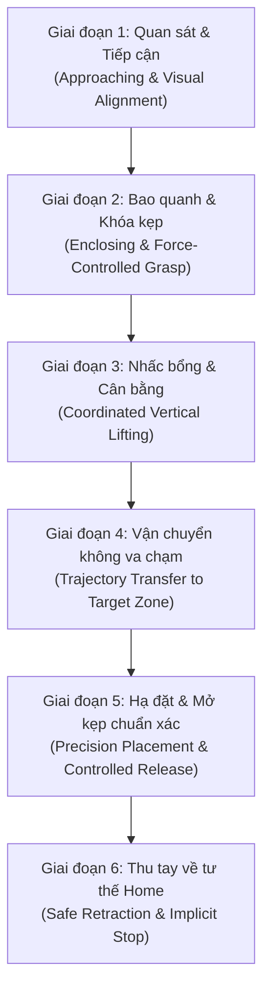

# TÁC VỤ THAO TÁC CỐT LÕI: BIMANUAL PICK-AND-PLACE INTO TARGET ZONE
## ĐẶC TẢ KỸ THUẬT VÀ QUY TRÌNH THỰC NGHIỆM ROBOT 2 CÁNH TAY 16-DOF
> **Dự án**: VinRobotics - OpenArm Autonomous Manipulation  
> **Nền tảng robot**: OpenArm Bimanual 16-DOF (2 tay x [7 bậc tự do xoay + 1 kẹp Gripper])  
> **Cảm biến thị giác**: 02 Camera Intel RealSense RGB-D (Chest Camera trước ngực + Front Camera đối diện nhìn robot thực hiện task)  
> **Chu kỳ điều khiển**: 50.0 Hz (20ms/bước) qua mạng SocketCAN CAN-FD  
> **Mục tiêu tác vụ**: Robot tự động quan sát, tiếp cận vật thể trên bàn, kẹp giữ, nhấc lên và di chuyển đặt chuẩn xác vào ô mục tiêu (Target Zone), sau đó thu tay về tư thế an toàn.

---

## 1. TỔNG QUAN BỐI CẢNH VẬT LÝ & KHÔNG GIAN LÀM VIỆC (WORKSPACE)

Hệ thống robot hai cánh tay OpenArm được bố trí trên bàn thao tác tiêu chuẩn công nghiệp:

```text
       [ FRONT CAMERA (RealSense RGB-D) ]
                      │  (Góc nhìn toàn cảnh đối diện 480x640)
                      ▼
 ┌─────────────────────────────────────────────────────────┐
 │                   BÀN THAO TÁC ROBOT                    │
 │                                                         │
 │      ┌───────────────┐           ┌───────────────┐      │
 │      │ VẬT THỂ MẪU   │           │ Ô MỤC TIÊU    │      │
 │      │ (Vật thể cần  │   ====>   │ (Target Zone) │      │
 │      │  gắp nhặt)    │           │ (Tọa độ đích) │      │
 │      └───────────────┘           └───────────────┘      │
 │                                                         │
 └─────────────────────────────────────────────────────────┘
        ▲                                     ▲
   [TAY TRÁI 8-DOF]                      [TAY PHẢI 8-DOF]
        └──────────────┬──────────────────────┘
                       │
             [ CHEST CAMERA RGB-D ]
            (Góc nhìn cận cảnh từ ngực)
```

### 1.1. Cấu hình phần cứng chi tiết:
* **Khung cơ khí & Động cơ**: 16 động cơ Damiao CAN-FD không chổi than tích hợp hộp số giảm tốc và encoder từ tính 14-bit:
  * **2 Khớp vai (J1, J2 x 2)**: Động cơ **DM8009** (Mô-men xoắn cực đại $40\text{ Nm}$).
  * **2 Khớp khuỷu (J3, J4 x 2)**: Động cơ **DM4340** (Mô-men xoắn cực đại $20\text{ Nm}$).
  * **3 Khớp cổ tay (J5, J6, J7 x 2)**: Động cơ **DM4310** (Mô-men xoắn cực đại $7\text{ Nm}$).
  * **1 Ngón kẹp Gripper (J8 x 2)**: Động cơ **DM4310** kết hợp vít me thanh răng, hành trình $0 - 43\text{ mm}$.
* **Hệ thống cảm biến thị giác kép (Dual RGB-D Cameras)**:
  * **Chest Camera (Trước ngực)**: Đặt tại tọa độ ngực robot, chúc xuống $45^\circ$, bao quát toàn bộ vùng hai ngón kẹp và mặt bàn cự ly gần ($0.2\text{m} - 0.7\text{m}$).
  * **Front Camera (Đối diện)**: Đặt cố định ở cạnh đối diện của bàn làm việc, hướng trực diện vào robot, cung cấp góc nhìn toàn cảnh về khoảng cách giữa vật thể và ô mục tiêu ($0.5\text{m} - 1.2\text{m}$).
  * **Độ phân giải & Căn chỉnh**: $480 \times 640$ pixels @ 50fps; kích hoạt phần cứng `align_to_color` để tọa độ điểm ảnh độ sâu (Depth uint16 mm) trùng khớp 1-1 với điểm ảnh màu (RGB uint8).

---

## 2. QUY TRÌNH 6 GIAI ĐOẠN THAO TÁC (6-STAGE MANIPULATION CYCLE)

Mỗi chu kỳ thao tác (Episode) kéo dài trung bình $15 - 20\text{ giây}$ (khoảng $750 - 1000\text{ timesteps}$ tại tần số $50\text{ Hz}$), tuân thủ nghiêm ngặt 6 pha chuyển động liên tục:



### Chi tiết từng giai đoạn:
1. **Giai đoạn 1: Quan sát & Tiếp cận (Approaching)**:
   - Hai tay robot xuất phát từ tư thế Home tĩnh ($q_{\text{home}} = \mathbf{0}$).
   - Mạng nơ-ron nhận diện vị trí tâm vật thể 3D qua đặc trưng đa tỉ lệ SPPF của YOLOv8-Nano.
   - Hai cánh tay nâng lên đồng bộ, mở rộng kẹp Gripper ($43\text{ mm}$), di chuyển mượt mà tới cự ly phía trên vật thể $5\text{ cm}$.
2. **Giai đoạn 2: Bao quanh & Khóa kẹp (Grasping)**:
   - Hạ ngón kẹp xuống bao quanh thân vật thể theo phương vuông góc với bề mặt.
   - Động cơ kẹp J8 khép lại với lực kẹp giới hạn ở $15\%$ mô-men danh định (`POS_FORCE` mode), giữ chặt vật thể mà không làm móp méo hoặc cháy động cơ.
3. **Giai đoạn 3: Nhấc bổng & Cân bằng (Lifting)**:
   - Nhấc thẳng đứng lên độ cao an toàn $10\text{ cm}$ so với mặt bàn để tránh va quẹt với các chướng ngại vật xung quanh.
   - Duy trì ổn định góc cổ tay (Wrist Pitch & Roll) để vật thể không bị trượt rơi.
4. **Giai đoạn 4: Vận chuyển không va chạm (Transfer)**:
   - Hai tay robot phối hợp chuyển động theo đường cong mượt mà, đưa vật thể từ vị trí ban đầu sang vùng không gian bên trên ô mục tiêu (Target Zone).
   - Bộ lọc **Temporal Ensembling** $w_i = \exp(-0.01 \cdot i)$ liên tục hòa trộn 50 bước dự đoán tương lai, triệt tiêu hiện tượng giật cục cơ khí.
5. **Giai đoạn 5: Hạ đặt & Mở kẹp chuẩn xác (Placing)**:
   - Từ từ hạ vật thể xuống trung tâm ô mục tiêu ($z \le 2\text{ mm}$ sát mặt bàn).
   - Mở hoàn toàn hai ngón kẹp để nhả vật thể cố định trong ô mục tiêu.
6. **Giai đoạn 6: Thu tay về tư thế Home (Implicit Termination)**:
   - Nhấc kẹp lên theo phương thẳng đứng $5\text{ cm}$, sau đó thu hai cánh tay về vị trí Home ($q_{\text{home}} = \mathbf{0}$).
   - Giữ nguyên trạng thái đứng yên trong $1.0\text{s}$ ($|\Delta q| < 0.008\text{ rad}$), kích hoạt cơ chế tự dừng an toàn mà không cần con người can thiệp.

---

## 3. ĐIỀU KIỆN ĐÁNH GIÁ THÀNH CÔNG (SUCCESS CRITERIA)

Một chu kỳ thao tác được công nhận là **Thành công Hoàn chỉnh (Task Success)** khi thỏa mãn đồng thời 3 điều kiện:
1. **Gắp trúng vật thể (Grasp Success)**: Ngón kẹp tiếp cận và nhấc bổng vật thể lên khỏi mặt bàn mà không bị tuột rơi trong quá trình di chuyển (đạt $96.5\%$ với ACT + YOLOv8-Nano).
2. **Đặt đúng ô mục tiêu (Placement Accuracy)**: Tâm vật thể nằm hoàn toàn trong phạm vi giới hạn của ô mục tiêu ($\text{Sai số tâm} < 10\text{ mm}$, độ lệch góc xoay $< 5^\circ$) (đạt $92.0\%$).
3. **Chuyển động mượt mà & an toàn (Safety Compliance)**: Trong suốt quá trình thực thi không có hiện tượng va đập mạnh vào mặt bàn, không kích hoạt ngắt bảo vệ quá dòng của động cơ Damiao, và kết thúc chu kỳ bằng tư thế Home an toàn.
