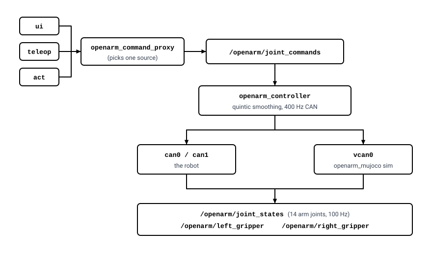

# OpenArm workspace

A ROS 2 workspace for the bimanual OpenArm: a CAN controller for the Damiao
motors, a MuJoCo simulator that answers the same CAN traffic, a web dashboard,
and the pieces around them.

Nothing here talks to the arm except `openarm_controller`, and everything that
drives the arm goes through one topic. That makes it the same stack whether the
motors are real or simulated: point the controller at `vcan0` and MuJoCo is the
robot.
<p align="center">
  
</p>

## Packages

| Package                   | What it does                                                                                                                                                                   |
| ------------------------- | ------------------------------------------------------------------------------------------------------------------------------------------------------------------------------ |
| `openarm_controller`    | Drives the Damiao motors over SocketCAN at 400 Hz, publishes joint state at 100 Hz. Smooths sparse commands with a quintic, holds per-joint PD gains in named profiles.        |
| `openarm_command_proxy` | Chooses which source commands the arm and merges its arm and gripper topics into one.                                                                                          |
| `openarm_ui`            | Web dashboard: 3D view of the robot and of the planned pose, sliders, an IK goal at each gripper tip, zero pose, the camera views (chest, front), telemetry and PD gains, episode recording with one camera or two, the ACT and SmolVLA controls and model loading. Connect brings up the controller for the mode you pick, and MuJoCo in sim. |
| `openarm_camera`        | The two RealSense cameras, chest and front: a driver and an RGB-D preprocessor (paired, 640x480, 25 Hz) per camera, each chosen by serial number; a virtual (black) camera for one that is not plugged in. |
| `openarm_act`           | Runs the ACT policy (an ONNX export of act_pipeline) on the live RGB-D and joints: one trajectory at a time, or continuously. Previews on the dashboard; drives the arm only after Execute / Run. |
| `openarm_smolvla`       | The same node running SmolVLA, which an openarm_smolvla server on a GPU machine serves over websocket. Commands as the `smolvla` source. |
| `openarm_mujoco`        | Upstream MuJoCo models, with a node added that answers CAN as the 16 motors.                                                                                                   |
| `bringup`               | One launch file that starts the subsystems.                                                                                                                                    |
| `openarm_can`           | Upstream submodule: the C++ CAN library and its tools.                                                                                                                         |
| `realsense-ros`         | Upstream submodule: the camera driver.                                                                                                                                         |

Outside `src/`:

| Path                    | What it is                                                                                  |
| ----------------------- | ------------------------------------------------------------------------------------------- |
| `run_main.sh`           | Starts everything in one command: CAN, build if needed, and bringup for what is plugged in. |
| `setup_can.sh`          | Brings up `vcan0` (MTU 72) and/or `can0`/`can1`; `status` only reports.                     |
| `setup_camera.sh`       | Sets up the RealSense cameras: which is chest and which front, udev rules, USB buffer; `status` only reports. |
| `cameras.yaml`          | Which RealSense is which camera, by serial (git-ignored, written by `setup_camera.sh`).     |
| `utils/setup_env.sh`    | uv environment for exporting models, with the right onnxruntime build (GPU or CPU).         |
| `utils/export_onnx.py`  | Exports an act_pipeline `.pth` to the `.onnx` openarm_act runs.                             |
| `checkpoint/`           | Models (git-ignored): `pth/` from training, `onnx/` their exports.                          |
| `dataset/`              | Recorded episodes (git-ignored), one folder per day.                                        |

## Getting started

Install `git-lfs` first. The meshes are stored with it, and a clone made
without it gets small pointer files in their place: the build still succeeds,
but the dashboard's 3D view silently fails to load.

```bash
sudo apt install git-lfs && git lfs install

git clone --recurse-submodules https://github.com/NgToanRob/openarm_mc.git
cd openarm_mc
git lfs pull
```

An existing clone that is missing one or the other:

```bash
git submodule update --init --recursive   # openarm_can, realsense-ros
git lfs pull                              # the meshes
```

### Dependencies

ROS 2 Humble, plus a few Python packages that rosdep does not carry:

```bash
rosdep install --from-paths src --ignore-src -r -y
python3 -m pip install --user mujoco h5py websockets msgpack
sudo apt install libcli11-dev          # openarm_can's CLI tools
```

`mujoco` is needed by the simulator, `h5py` by the episode recorder,
`websockets` by the dashboard, `msgpack` (with `websockets`) by
openarm_smolvla. Install them for the same interpreter ROS uses,
which is `/usr/bin/python3` — not a conda or venv interpreter.

### The uv environment (exporting models, and ACT)

Two Python environments, kept apart on purpose:

- **System Python** (`/usr/bin/python3`): every ROS node, openarm_act
  included. It needs `onnxruntime` (or `onnxruntime-gpu`) to run a model.
- **uv environment** (`.venv/`, from `pyproject.toml` and `uv.lock`): only
  the tools in `utils/`, chiefly `export_onnx.py`, which needs torch. No ROS.
  The dashboard's **Load…** uses it too, to export a `.pth`.

```bash
curl -LsSf https://astral.sh/uv/install.sh | sh   # once, if uv is missing

./utils/setup_env.sh            # the uv environment
./utils/setup_env.sh --system   # ... and onnxruntime, msgpack on the system Python
```

`setup_env.sh` picks the onnxruntime build for the machine: `onnxruntime-gpu`
when `nvidia-smi -L` lists a GPU on x86_64, `onnxruntime` otherwise (on ARM
there is no GPU wheel). `--cpu` / `--gpu` skip the detection. It ends by
printing the providers each interpreter got, e.g.
`CUDAExecutionProvider, CPUExecutionProvider`. It amounts to:

```bash
uv sync --extra cpu        # or --extra gpu; the two cannot share .venv
/usr/bin/python3 -m pip install --user onnxruntime "numpy<2"   # --system
```

What makes it reproducible:

- `.python-version` pins Python 3.10 (Ubuntu 22.04's, which ROS Humble uses);
  uv downloads it when the machine has another.
- `uv.lock` pins every package. Torch comes from the PyTorch CPU index:
  the export runs on the CPU, and this spares the multi-GB CUDA download.
- `numpy<2` everywhere: `cv_bridge` on Humble is built against numpy 1.

The locked set installs on Linux x86_64 (CPU and GPU), Linux aarch64 (CPU)
and Windows x86_64. Two things it does not cover: onnxruntime-gpu needs the
CUDA 12 and cuDNN 9 runtime libraries -- without them it falls back to the
CPU, and openarm_act says so -- and the export needs act_pipeline itself
(the OpenArm_MC repository) on the machine, found through `--act_pipeline`,
`$OPENARM_ACT_PIPELINE` or `~/Project/OpenArm_MC`.

Run the tools with `uv run`, which uses `.venv` without activating it:

```bash
uv run utils/export_onnx.py --checkpoint checkpoint/pth/best_checkpoint.pth
```

After changing a dependency in `pyproject.toml`, run `uv lock` and commit
`uv.lock` with it.

### Build

```bash
colcon build --symlink-install
```

With `--symlink-install`, adding or deleting files under `openarm_ui/web`
leaves stale entries behind. Remove that package's output when files move:

```bash
rm -rf build/openarm_ui install/openarm_ui && colcon build --symlink-install
```

## Running

### Quick start

```bash
./run_main.sh
```

works out the rest from what is plugged in, and says what it found:

- **robot**: `can0` and `can1` up → the real arm; otherwise MuJoCo on `vcan0`.
  It runs `setup_can.sh` first when a link needs it (asking for sudo only then).
- **cameras**: chest and front, as `setup_camera.sh` assigned them -- a
  RealSense plugged in → its driver and preprocessor; one that is not → a
  virtual camera with black frames, so the dashboard, the recorder and the
  policies still run (a continuous run refuses to drive the arm on one).
- **ACT**: a model at `$OPENARM_ACT_MODEL` or the newest
  `checkpoint/onnx/**/*.onnx` → the policy, idle until asked. It falls back to
  the CPU when the installed onnxruntime has no CUDA.

It also refuses to start next to a stack that is still running, or on a
taken port. Any of it can be forced:

| Option               | Meaning                                    |
| -------------------- | ------------------------------------------ |
| `--real` / `--sim`   | which robot                                |
| `--no-camera`        | no cameras at all, not even virtual ones   |
| `--cameras <list>`   | only these: `chest`, `front`, `chest,front` |
| `--act <model.onnx>` | this model; `--no-act` none                |
| `--cpu`              | run the model on the CPU                   |
| `--build`            | `colcon build` first                       |
| `--port <n>`         | dashboard port (8080)                      |
| `-- <name>:=<value>` | passed straight to `ros2 launch`           |

The motors stay off until Connect on the dashboard, and the arm stays still
until a command source is chosen there.

### By hand

CAN first, before ROS is sourced. It is a once-per-boot step:

```bash
./setup_can.sh          # vcan0 for the simulator, can0/can1 if an adapter is there
./setup_can.sh status   # check, change nothing
```

The cameras once per machine, and again when one is swapped
([Cameras](#cameras)):

```bash
./setup_camera.sh          # udev rules, USB buffer, which camera is chest and which front
./setup_camera.sh status   # check, change nothing
```

Then:

```bash
source /opt/ros/humble/setup.bash
source install/setup.bash

ros2 launch bringup bringup.launch.py
```

Open [http://localhost:8080](http://localhost:8080), pick `Real` or `Sim`, and
press connect. The dashboard brings up the controller for the mode you chose,
and MuJoCo with it in sim, so the same launch serves both. Leaving
`enable_controller` at its default starts a controller on the robot's buses
too, which saves the page a restart when you only ever drive the real arm.

Three gates stand between a launch and a moving arm, on purpose:

- **Mode** is which robot the controller drives. Switching restarts it,
  because the bus is fixed once its CAN threads are up.
- **Connect** arms the motors. Until then the arm is limp.
  `auto_enable:=true` has the controller arm them at startup instead.
- **Command source** is who may move them. Nothing reaches the arm until you
  choose one; pick `ui` to drive from the page.

Connect reports what actually answered -- `connected to the robot on can1, can0 -- 16 motors answering` -- and fails when nothing does. The count is
worth trusting: `joint_states` is published whether or not the motors are
there, filling in zeros for one that has never replied, so an unpowered arm
would otherwise look exactly like a working one.

### Launch arguments

| Argument              | Default   | Meaning                                                                   |
| --------------------- | --------- | ------------------------------------------------------------------------- |
| `use_sim`           | `false` | `true` points the controller at `vcan0` with `right_id_offset:=32`  |
| `enable_sim`        | `false` | start the MuJoCo simulator                                                |
| `enable_camera`     | `true`  | start the cameras (real or virtual)                                       |
| `cameras`           | `auto`  | `auto` (chest and front), or `chest`, `front`, `chest,front`              |
| `virtual`           | `auto`  | a camera not plugged in becomes a virtual one; `none` starts only real ones, `all` none of them real |
| `enable_controller` | `true`  | `false` leaves the controller to the dashboard's connect                |
| `enable_proxy`      | `true`  |                                                                           |
| `enable_ui`         | `true`  |                                                                           |
| `viewer`            | `true`  | the simulator's own MuJoCo window                                         |
| `active_source`     | `none`  | which source may command the arm at startup                               |
| `auto_enable`       | `false` | `true` arms the motors at startup; otherwise connect from the dashboard |
| `enable_act`        | auto    | `true` when there is a model: `$OPENARM_ACT_MODEL`, or the newest `.onnx` under `checkpoint/onnx/` |
| `checkpoint`        | auto    | the model ACT runs, by the same rule as `enable_act`                      |
| `device`            | `auto`  | ACT on `cuda` when onnxruntime has it, else `cpu`; `cuda:<n>` picks a GPU |
| `http_port`         | `8080`  | dashboard port                                                            |
| `width`, `height`, `rate` | `640`, `480`, `25` | the frames each camera's preprocessor hands the policies and the recorder; `color_profile` / `depth_profile` (`640x480x30`, the camera's native size) set the driver's |

Each subsystem also launches on its own, which is easier to read when
something misbehaves:

```bash
ros2 launch openarm_mujoco sim.launch.py
ros2 launch openarm_controller controller.launch.py use_sim:=true
ros2 launch openarm_command_proxy proxy.launch.py
ros2 launch openarm_ui ui.launch.py
ros2 launch openarm_camera camera.launch.py
```

## Cameras

Two RealSense RGB-D cameras, each by its role:

| Camera  | Where                                         |
| ------- | --------------------------------------------- |
| `chest` | on the robot's chest -- the policies' camera, and the datasets' since the start |
| `front` | across the table, looking back at the robot   |

Which RealSense is which is its serial number, kept in `cameras.yaml` at
the workspace root (machine-specific, git-ignored). `setup_camera.sh`
writes it, in the manner of `setup_can.sh`:

```bash
./setup_camera.sh                    # setup: the host, then the roles
./setup_camera.sh status             # the cameras, their roles, what the launch will start
./setup_camera.sh assign front 234567890123
./setup_camera.sh switch             # chest <-> front, at once in the cameras running too
./setup_camera.sh forget front
./setup_camera.sh plan               # a line per camera: "<role> realsense <serial>" or "<role> virtual"
```

**Chest showing the front camera?** `./setup_camera.sh switch`, or
**⇄ Switch chest / front** on the dashboard's camera card, swaps the two:
in `cameras.yaml` for the next start, and at once in the cameras running --
each camera's preprocessor reads the other one's driver (its `source`
parameter), so no driver restarts and the picture changes in a moment.
With one camera virtual, the swap is saved and shows when the cameras next
start.

`setup` keeps the role of a camera it already knows; a new camera gets the
free role, chest first; two new ones are told apart by unplugging one when
it asks ("Unplug the FRONT camera now"), since they look the same. It also
does what two cameras need of the host, asking for sudo only then:

- **udev rules**: librealsense's own, for the version installed, so the
  cameras open without root (once per machine; unplug and replug after).
- **usbfs buffer**: 1000 MB instead of the kernel's 16 -- two cameras
  streaming through libusb overrun the default. It lasts until the next
  reboot; `usbcore.usbfs_memory_mb=1000` on the kernel command line keeps it.

`status` also warns about a camera on USB 2, too slow for 640x480 RGB-D at
30 fps: give each camera a USB 3 port, on separate controllers if they can.

At launch each camera gets its driver (`realsense2_camera` on its serial)
and preprocessor, or, when its RealSense is not plugged in, a **virtual
camera**: black frames, depth 0, on the same topics at the same size and
rate, stamped `<camera>_virtual`. The simulator then runs with both cameras
and no hardware; the dashboard marks a virtual camera, the recorder notes it
in the episode, and a policy's continuous run will not drive the arm on
one (a one-shot trajectory says it was generated blind). With no
`cameras.yaml` yet, a single RealSense is the chest camera, as before.

```bash
ros2 launch openarm_camera camera.launch.py                  # chest and front
ros2 launch openarm_camera camera.launch.py cameras:=chest
ros2 launch openarm_camera camera.launch.py virtual:=none    # real cameras only
ros2 run openarm_camera virtual_camera --name front          # one virtual camera by hand
```

## Dashboard

The panel under the 3D view follows the command source: the sliders for
`ui`, the camera and joint state for `teleop`, the camera and the policy's
controls for `act` and for `smolvla`.

- **Robot**: `Real` / `Sim` and one Connect/Disconnect button, with a banner
  saying what answered.
- **Command source**, and **Zero pose**: eases every arm joint to 0 from
  wherever the arm is, whoever was driving (grippers stay as they are). It
  cuts the old source off at the proxy, stops a policy that was executing,
  and afterwards hands the arm to no one, or back to the sliders when they
  were driving. Pressed again, it stops where it is.
- **Joint sliders** stage a plan, drawn as a ghost in the 3D view; **Execute**
  sends it. Each joint has a lock, and only unlocked joints move: the rest
  are held at the controller's setpoint, not re-sent from the measured pose,
  which would let them sag. **Home** stages the home pose, **Sync** copies
  the robot's pose into the sliders.
- **Goal** (above the 3D view): pick `Left` or `Right` and drag the gizmo at
  that gripper tip, arrows to move and rings to turn, as MoveIt's
  interactive marker does. Inverse kinematics in the page poses the ghost and
  the sliders to reach it, and says how far off it is when it cannot.
  **Plan** turns it into a joint-space trajectory from the robot to the goal
  and hands it to the policy whose card is up -- openarm_act
  (`/openarm_act/plan`) or openarm_smolvla -- or else to the one running,
  which draws it and runs it on **Run trajectory** like one the model
  generated.
- **Cameras**: each camera's RGB-D pair, as the policies and the recorder see
  it: pick **Chest**, **Front** or **Both**, and **RGB**, **Depth** or
  **Both** -- a row per camera, a column per stream. A virtual camera's
  frames are black, marked *virtual*. **⇄ Switch chest / front** swaps the
  two cameras when they were assigned the wrong way round. Off by default, since the server only
  subscribes to a stream while a page is showing it; the choices are
  remembered per browser.
- **ACT policy**, **SmolVLA policy**, **Recording**: below. The SmolVLA card
  is the ACT card for openarm_smolvla, with the task its model was trained
  on and the server in place of the model list.
- **Telemetry / PD Gains**: the joint table, and the gains of the active
  profile, editable live. The **Interpolator** picks how commands become the
  controller's 400 Hz setpoint: `quintic` (default; segments within each
  joint's speed and acceleration limits) or `filter4`, a critically damped
  fourth-order filter whose `w` sets its lag (a smooth stream is followed
  about `4/w` s behind).

## Topics

Commands follow openarm_can's convention: the fourteen arm joints travel
together, each gripper has its own topic, and a gripper is a finger stroke in
metres rather than an angle.

| Topic                                      | Type                  | Contents                                             |
| ------------------------------------------ | --------------------- | ---------------------------------------------------- |
| `/openarm/<source>/joint_commands`       | `Float64MultiArray` | 14 values:`left_j1..j7` then `right_j1..j7`, rad |
| `/openarm/<source>/left_gripper`         | `Float64MultiArray` | `data[0]`: stroke, 0.0 closed .. 0.043 open        |
| `/openarm/<source>/right_gripper`        | `Float64MultiArray` |                                                      |
| `/openarm/joint_commands`                | `JointState`        | what the proxy forwards, named joints                |
| `/openarm/controller/joint_commands`     | `JointState`        | the setpoint the controller writes to CAN, 100 Hz, whether or not a source commands |
| `/openarm/joint_states`                  | `JointState`        | the 14 arm joints, 100 Hz                            |
| `/openarm/left_gripper`                  | `Float64MultiArray` | `[stroke, stroke rate, effort]`                    |
| `/openarm/right_gripper`                 | `Float64MultiArray` |                                                      |
| `/openarm/camera/<camera>/rgb`, `.../depth` | `Image`     | `chest`, `front`: paired, 640x480, 25 Hz (frame_id `<camera>_virtual` from a virtual camera) |
| `/openarm/trajectory`                    | `JointTrajectory`   | each ACT inference's 50 steps, 20 ms apart, the 16 joints from the observation on |
| `/openarm/act/status`                    | `String`            | the ACT node's state as JSON, for the dashboard      |
| `/openarm/act/preview`                   | `JointState`        | the policy's current action, the 16 joints           |
| `/openarm_act/plan`                      | `JointTrajectory`   | a trajectory from outside (the dashboard's Goal → Plan), kept and run like a generated one |

`<source>` is one of the names in
`openarm_command_proxy/config/sources.yaml` — `ui`, `teleop`, `act` and
`smolvla` out of the box. Adding one is a line in that file.

## Parameters worth knowing

Everything the dashboard changes is a parameter on another node, so the same
things work from a terminal.

```bash
# which source may drive the arm
ros2 param set /openarm_command_proxy active_source teleop

# motors on and off; off lets the arm fall limp
ros2 param set /openarm_controller motors_enabled false

# how many motors are replying on CAN; reported by the controller, not set
ros2 param get /openarm_controller motors_answering

# PD profile: default, teleop, act
ros2 param set /openarm_controller active_profile teleop
ros2 param set /openarm_controller gains.default.left_j1.kp 90.0

# how commands become the 400 Hz setpoint: quintic, or filter4 with its w
ros2 param set /openarm_controller interpolator filter4
ros2 param set /openarm_controller interp_w 30.0

# a continuous ACT run: async or sync loop, speed limits, ensemble weight
ros2 param set /openarm_act loop_mode sync
ros2 param set /openarm_act vel_scale 0.5
ros2 param set /openarm_act ensemble_k 0.02

# slow the simulator down, or freeze it
ros2 param set /openarm_mujoco_sim realtime 0.25
ros2 param set /openarm_mujoco_sim paused true
```

Gains are per joint and per profile, in
`openarm_controller/config/gains.yaml`. A DM8009 carrying a shoulder and a
DM4310 on a wrist want nothing like the same numbers; the `default` profile is
openarm_can's own table.

## ACT policy

The model is trained with act_pipeline (OpenArm_MC); this repository only
runs it.

### Getting a model

Every model lives under `checkpoint/` (git-ignored): the training `.pth`
files in `checkpoint/pth/`, their exports in `checkpoint/onnx/`. Bringup,
`act.launch.py` and `run_main.sh` start the newest `.onnx` found there
(`$OPENARM_ACT_MODEL` or `checkpoint:=` names another).

The export runs in the uv environment (see
[above](#the-uv-environment-exporting-models-and-act)), and writes
`checkpoint/onnx/<checkpoint name>/policy.onnx` by default, its
`dataset_stats.*` beside it.

Or skip all of it: **Load…** in the dashboard's ACT card takes a file from a
picker -- an `.onnx` is kept under `checkpoint/onnx/`, a `.pth` under
`checkpoint/pth/` and exported first -- and loads it. The list beside it
swaps between the models already there, while nothing runs.

```bash
./utils/setup_env.sh            # --system for the ROS side too
uv run utils/export_onnx.py --checkpoint checkpoint/pth/best_checkpoint.pth
#   -> checkpoint/onnx/best_checkpoint/policy.onnx
ros2 launch bringup bringup.launch.py enable_act:=true \
    checkpoint:=$PWD/checkpoint/onnx/best_checkpoint/policy.onnx
```

The export checks itself against the checkpoint and carries the
normalisation stats, so the `.onnx` is the only file to copy. The node feeds
the model exactly what act_pipeline trained on -- ImageNet-normalised RGB and
depth scaled over 0.2-1.2 m at 640x480, Z-scored joints -- and ensembles the
chunks the way its `TemporalEnsemblePolicy` does. Every path uses 640x480,
the camera's native size: the camera, the recorder, the node. A model
trained at another size (424x240, say) is refused, at launch and on Load, rather than run on
stretched frames, and `export_onnx.py` will not export one. With no frames
from a camera it feeds a gray frame at 600 mm, as act_pipeline's
`infer_robot.py` does, and says so (`camera_fallback: off` refuses instead);
from a virtual camera it gets its black frames. Either way it may preview,
and a trajectory generated so says "not seeing: ..."; a continuous
Execute is refused, which would drive the arm blind.

A policy says which cameras it reads (`policy.cameras`, the first being the
one `predict()`'s `rgb` and `depth` come from), and the node subscribes to
`/openarm/camera/<camera>/{rgb,depth}` for each. An ACT export reads
`chest`; a policy reading more gets the others as
`predict(rgb, depth, qpos, cameras={"front": (rgb, depth)})`.

### One trajectory

It always starts **idle**: the model is loaded and nothing is inferred.
**Generate trajectory** in the ACT card runs the model once on the live
camera and joints, publishes the chunk on `/openarm/trajectory` and rests
again; the dashboard says when it is ready and draws an arrow per gripper
(cyan left, magenta right) along its 50 steps (one second). Nothing is sent
to the robot. **Run trajectory** runs that trajectory once: it eases the arm
onto the first step with a 1.5 s S-curve, plays the 50 steps at 50 Hz, and
the arm then holds. What runs must be what was drawn: it refuses a
trajectory older than 30 s (`plan_max_age`), one the arm has moved away
from since (`plan_max_drift`), or one whose first step is far from the arm
(`plan_max_start_jump`) -- generate it again. **Reset to zero** eases the
arm to every joint at 0 with the grippers open (`reset_pose`), which is how
the recorded episodes start: with them closed the policy reads the task as
done and hardly moves. **Stop** holds the arm where it is, at any time.
The same from a terminal:

```bash
ros2 service call /openarm_act/reset std_srvs/srv/Trigger      # optional
ros2 service call /openarm_act/generate std_srvs/srv/Trigger
ros2 param set /openarm_command_proxy active_source act
ros2 param set /openarm_act mode execute
```

A trajectory planned on the dashboard with **Goal → Plan** arrives on
`/openarm_act/plan` and runs the same way.

### Continuous run

**Start** (`running: true`) infers continuously, as `infer_robot.py` does:
every step takes the first action of the overlapping chunks, the newest
weighing most, and the arrows follow the newest chunk. Nothing moves until
**Execute** (`mode: execute`). The card sets four things for it:

- **speed** (`vel_scale`, 0.1-2): scales `infer_robot.py`'s per-joint speed
  and acceleration limits.
- **ensemble m** (`ensemble_k`): chunk weights `exp(-m * age)`.
- **time** (`execute_timeout`, s): how long Execute may run before it stops
  by itself; 0 for no limit. It can be changed during a run.
- **loop** (`loop_mode`): `async` steps the arm at 50 Hz on the newest chunks
  while the model infers beside it, so the arm moves at the recorded speed
  however fast inference is; `sync` is `infer_robot.py`'s loop as written
  (observe, infer, one step), so the arm moves as fast as the model infers.

A run ends by itself as `infer_robot.py`'s does: after **time** (30 s by
default), or once the arm is back within 0.15 rad of home with
the command within 0.008 rad of it for 1 s (`stop_home_dist`,
`stop_delta_rad`, `stop_duration`) -- after it has left home. It then eases
the arm to `finish_pose` (every joint at 0, grippers closed) over 2 s at
least. **Stop** never does that: it holds the arm where it is.

## SmolVLA policy

[openarm_smolvla](https://github.com/hoanglmv/openarm_smolvla) fine-tunes
SmolVLA on the same episodes, and serves it: the model needs Python 3.12,
LeRobot and a GPU, so it runs there, and the `openarm_smolvla` package here
asks it for each chunk over websocket. The node is openarm_act's under
another name (`/openarm_smolvla`), so a run goes exactly as one of ACT's --
idle first, one trajectory or continuous, chunks ensembled at 50 Hz, the
same ease-in, refusals, Stop, Reset and way home -- and every parameter in
`act.yaml` works on it. The frames go raw; the server resizes, encodes the
depth and normalises, in the code that trained the model.

On the GPU machine, in openarm_smolvla:

```bash
uv run scripts/serve.py checkpoint=releases/<name> port=8000
```

Here:

```bash
ros2 launch bringup bringup.launch.py enable_smolvla:=true server:=ws://<gpu-host>:8000
#   or on its own: ros2 launch openarm_smolvla smolvla.launch.py server:=...

ros2 service call /openarm_smolvla/generate std_srvs/srv/Trigger
ros2 param set /openarm_command_proxy active_source smolvla
ros2 param set /openarm_smolvla mode execute            # run that trajectory once

ros2 param set /openarm_smolvla running true            # or continuously, previewing
ros2 param set /openarm_smolvla mode execute
ros2 param set /openarm_smolvla mode preview            # the arm holds
```

- **cameras** are the server model's: its metadata lists them (`chest`,
  `chest_depth`, and `front`, `front_depth` for a model trained on both),
  and the node sends each one's frames by that name.
- **server** (`$OPENARM_SMOLVLA_SERVER`, else `ws://localhost:8000`) is the
  node's `checkpoint` parameter: set it while idle to switch servers. A
  server whose model was trained on frames other than 640x480 is refused.
- **No prompt.** The model is trained on one task -- every episode gets
  the same one from openarm_smolvla's `manifests/episodes.yaml` -- so the
  node sends none and the server feeds the model that task, exactly as in
  training. A server whose model has several tasks (no default) is
  refused; `serve.py default_prompt=...` gives it one.
- Its topics are the `smolvla` source's, `/openarm/smolvla/*`, and its
  chunks go to `/openarm/smolvla/trajectory`. Picking `smolvla` as the
  command source on the dashboard brings up its card: Start / Execute,
  Generate / Run trajectory, Reset, Stop, speed, ensemble, time and loop
  as on the ACT card, plus the task, the server and its round trip.
- A new chunk every half second (`query_period: 25`), asked for beside the
  50 Hz steps (`loop_mode: async`), so the round trip does not slow the arm.
  A chunk that takes over `request_timeout` (15 s), or a lost connection,
  fails that inference; the next reconnects.
- Until the server answers, the node exits saying so and launch starts it
  again every 5 s (`respawn:=false` does not).
- Targets are clipped to OpenArm V1's joint limits (`clip_to_limits`).
- **Grasping.** The model is trained on the measured joints
  (`action_source: qpos`), so for a grasp it predicts the stroke the
  fingers stopped at on the object -- ~24 mm on the green box -- while
  teleop commanded 0: sent as is, the gripper reaches the box and squeezes
  nothing. A predicted stroke under `gripper_close_below` (0.035 m) is
  commanded to `gripper_close_to` (0) instead, and the gripper's effort
  limit holds the box. openarm_act has the same two parameters, off; an
  ACT model trained on the recorder's `action` (= qpos) may want them.
  Retraining with `data.action_source=commands` removes the need.
- Served from a CPU (no NVIDIA GPU) a chunk takes 3-7 s: Generate works,
  a continuous run cannot (a chunk is 1 s). Serve from a GPU machine.

Without a GPU, a stand-in server that holds the observed pose tries the
plumbing, in the simulator say:

```bash
python3 src/openarm_smolvla/test/fake_server.py --port 8000
```

## Recording

The dashboard records an episode in the ACT HDF5 format: sixteen joints at
50 Hz with paired 640x480 RGB-D frames from one camera or both -- tick
**chest** and **front** in the card -- written to `dataset/<day>/` in this
workspace -- `dataset/2026-10-08/episode_20261008_104216.hdf5` -- and
git-ignored (`OPENARM_DATASET_DIR` names another root). Each sample also
keeps the commanded joints (`joint_commands`, teleop's targets through the
proxy; NaN where there was none); `action` is the measured `qpos`. The
card shows while teleop drives. The clock beside the button turns amber
past 25 seconds, which is the top of the range the dataset contract expects.

Start recording answers at once (measured: 0.06-0.08 s): the next
episode's recorder process is started ahead of time and follows the
streams, and the button reads **Preparing…** until it is ready. Samples sit
on a fixed 20 ms grid: a tick that comes up to 80 ms late still fills the
slots it missed, with the newest state and frames (the zero-order hold the
sampling is anyway), and a longer stall leaves a gap. Each episode keeps
`late_samples` and `gaps`; when it is saved the card says its samples and
rate -- "252 samples, 50.0 Hz (1 filled late)". It writes the images
uncompressed (`<episode>.partial.hdf5`), since compressing a sample takes
longer than a 50 Hz step, and compresses them (lzf) in the background once
the recording stops; the partial file is removed only once the final one is
in place. A recording survives the dashboard being closed mid-episode, and
an interrupted compression is finished by hand:

```bash
python3 -m openarm_ui.episode_compress dataset/<day>/<episode>.partial.hdf5
```

Each camera is kept as `observations/images/<camera>_rgb` and
`<camera>_depth`, so an episode of the chest camera alone is the same file
as before the front one existed and the training pipelines read it
unchanged. `cameras_json` lists an episode's cameras and
`virtual_cameras_json` the ones that were virtual (black frames); the card
says which each camera is before you record, and refuses a camera with no
frames at all.

Stop saves the episode and compresses it, and the button reads
**Compressing… n s** until the final file is in place (about 2 s per second
of two-camera episode): nothing is recorded meanwhile, since the
compression would take CPU from it. The next episode's recorder is armed
on the cameras ticked during the compression, ready when it ends.

An episode is about 20 MB per second per camera, almost all of it images,
so the directory is ignored by git. Two cameras are 77 MB/s of frames into
one Python process; depth is clipped through a lookup table and a frame the
50 Hz sampling repeats is passed to the writer once, so it holds 50 Hz with
both (measured from the dashboard: 50.0 Hz, one sample in 250 filled late).
On a machine too busy for it, `late_samples` and `gaps` say so.

## Notes

- **The simulator needs `vcan0` at MTU 72.** A link left at the classic 16
  silently drops every CAN-FD frame, and this stack speaks FD. `setup_can.sh`
  sets it; openarm_can's own setup script does not.
- **One of everything.** Two controllers on one bus, or two dashboards on one
  port, fail in ways that look like something else. `Ctrl-C` on a launch does
  not always take its nodes with it, so check before starting again:
  ```bash
  pgrep -af "lib/openarm"
  ```
- **Two cameras want two USB 3 links.** On one controller, or with the
  usbfs buffer left at 16 MB, the second camera's driver starts and then
  delivers nothing, or both drop frames. `./setup_camera.sh status` checks
  the link and the buffer.
- **The meshes live in Git LFS.** 166 files and 139 MB of them, against 1.2 MB
  for everything else, so a clone that skips them is nearly free. GitHub's
  free tier allows 1 GB of LFS traffic a month, which is about seven full
  clones.
- **`openarm_mujoco` is vendored, not a submodule.** It carries local changes:
  a `can_bridge` node, ROS packaging, and a web page that defaults to the v1
  model. It was taken from upstream `1c1a2d4` (2026-10-02). Pulling upstream
  changes means merging them by hand.
